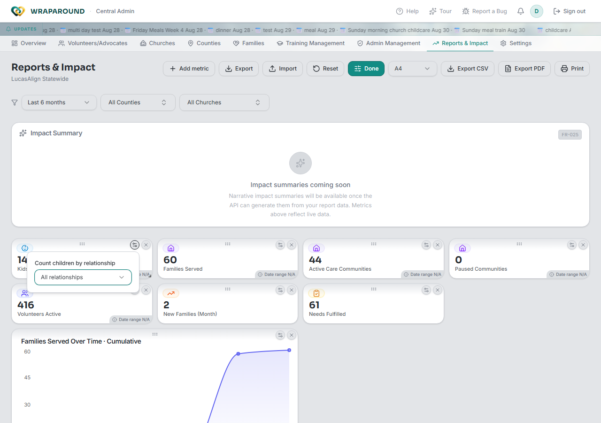

# Kids Served

**Who this is for:** Program staff (Admins and Coordinators).
**What it is:** A counter tile on the **Reports & Impact** page.

## What it shows

This tile shows how many children are in your records, a simple headcount of the kids your program is serving right now. By default it counts every child on file across all families in the current filters, whatever the family's status.

## Options you can change

Select **Options** (the gear icon) in the top-right corner of the tile to change what gets counted. You don't need to turn on **Edit Layout** first.

- **Count children by relationship** — by default this is set to **All relationships**. You can instead count only children of one relationship (for example, only foster children or only biological children). The list shows the relationships recorded on your children. When you pick one, the tile's name adds that relationship after a dot.

## Which filters affect it

- **County** and **Church** apply. They narrow the tile to children whose family is in that county or served by that church.
- **Date range does not apply.** This is a current headcount of the children on file, and the app doesn't record when each child was added, so there's no past window to count. The tile shows a small **"Date range N/A"** badge in its bottom-right corner to make this clear.

## Tips & notes

!!! note "One copy per report"
    Kids Served comes with every new report. You can only have one copy at a time. If you remove it, it shows up again under **Add metric → Metrics**, so you can add it back without resetting your report.

!!! note "It's a snapshot"
    The number reflects the children in your records as they stand today, not the children served during a particular time period.

## Related

- [Build a Reports & Impact report](../admin/reports-and-impact.md)
- [Families Served](families-served.md)
