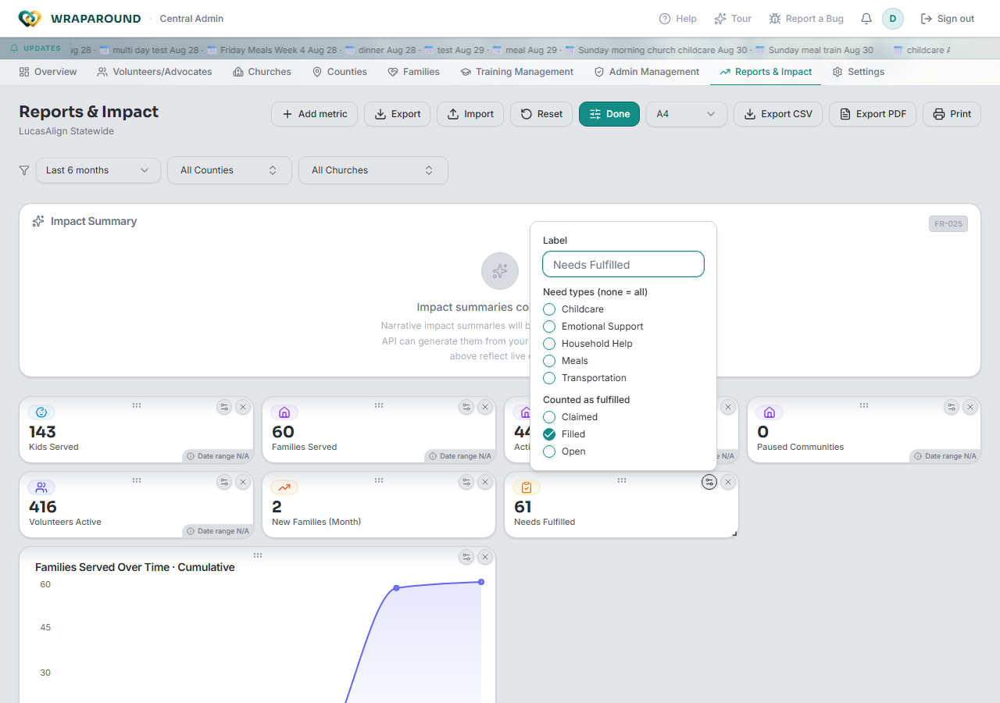

# Needs Fulfilled

**Who this is for:** Program staff (Admins and Coordinators).
**What it is:** A counter tile on the **Reports & Impact** page.

## What it shows

This tile counts the needs that have been met. By default it counts needs that are **Filled** or **Closed**, giving you a quick read on how much support has been delivered. You can add this tile to a report **more than once**, with each copy tracking different need types side by side.

## Options you can change

Select **Options** (the gear icon) in the top-right corner of the tile to change what gets counted. You don't need to turn on **Edit Layout** first.

- **Label** — give the tile a custom name, which is helpful when you add several copies (for example, "Meals Delivered" and "Rides Provided"). Leave it blank and the tile names itself after the need types you pick, or "Needs Fulfilled" when you pick none.
- **Need types (none = all)** — choose which types of need to count. Leaving none selected counts **all** types.
- **Counted as fulfilled** — choose which need statuses count as fulfilled. The list shows the statuses found on your needs (for example **Open**, **Filled**, **Closed**). **Filled** and **Closed** are checked by default.

## Which filters affect it

- **Date range**, **County**, and **Church** all apply.
- The **Date range** narrows the count by when each need was **last updated**. For a fulfilled need, that's roughly when it was fulfilled.
- **County** and **Church** use the county and serving church of the need's family.

## Tips & notes

!!! tip "Track need types side by side"
    Because you can add this tile more than once, give each copy its own **Label** and **Need types** to compare different kinds of support, such as meals versus transportation, on the same report.

## Related

- [Build a Reports & Impact report](../admin/reports-and-impact.md)
- [Trend chart](trend-chart.md)
- [Statuses explained](../../reference/statuses.md)
