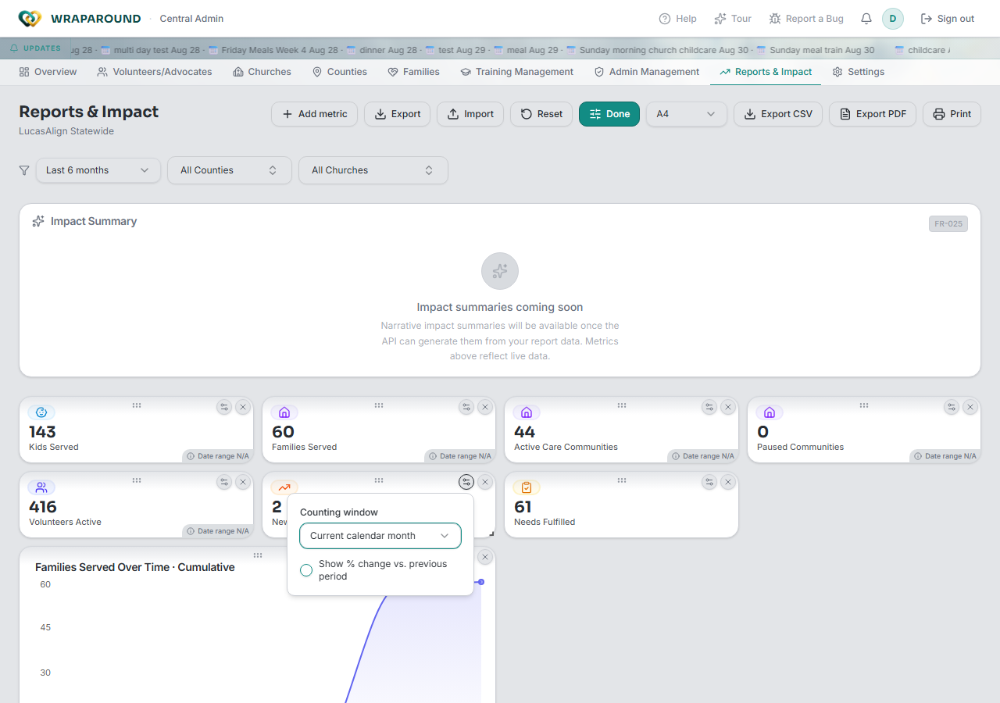

# New Families

**Who this is for:** Program staff (Admins and Coordinators).
**What it is:** A counter tile on the **Reports & Impact** page.

## What it shows

This tile counts the families added during a window of time. By default that window is the current calendar month, so you can see how many new families you've welcomed this month at a glance. The tile's name shows which window it's using: *New Families (Month)*, or the date range it's following, such as *New Families (6mo)*.

## Options you can change

Select **Options** (the gear icon) in the top-right corner of the tile to change what gets counted. You don't need to turn on **Edit Layout** first.

- **Counting window** — choose **Current calendar month** (the default) to always count families added in the current month, or **Follow date-range filter** to count families added during the period set by the page's Date range filter.
- **Show % change vs. previous period** — optionally show how this window compares to the one just before it, so you can see whether new families are trending up or down. In calendar-month mode, the month so far is compared with the same stretch of last month, so a partial month isn't measured against a full one. When there's nothing to compare against, the tile shows **— vs prev**.

## Which filters affect it

- **County** and **Church** apply. They narrow the tile to the families in that county or served by that church.
- **Date range applies only when** the counting window is set to **Follow date-range filter**. In calendar-month mode, the tile always uses the current month, ignores the Date range filter, and shows a small **"Date range N/A"** badge in its bottom-right corner.

## Tips & notes

!!! tip "Pick the window that fits your report"
    Use **Current calendar month** for a steady "this month" headline, or switch to **Follow date-range filter** when you want the tile to match the same period as the rest of your report.

!!! note "One copy per report"
    New Families comes with every new report. You can only have one copy at a time. If you remove it, it shows up again under **Add metric → Metrics**, so you can add it back without resetting your report.

## Related

- [Build a Reports & Impact report](../admin/reports-and-impact.md)
- [Trend chart](trend-chart.md)
