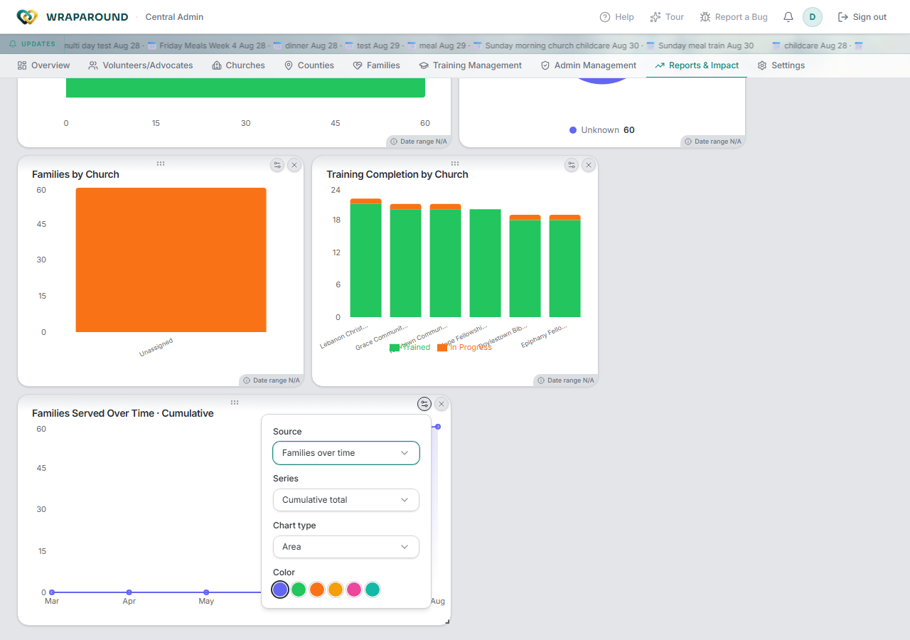

# Trend chart

**Who this is for:** Program staff (Admins and Coordinators).
**What it is:** A chart on the **Reports & Impact** page.

## What it shows

This chart plots activity over time, month by month, so you can see how things are trending. Depending on what you choose, it shows either how your families have grown over time or how much support was delivered each month, broken down by type of need. You can add it to a report **more than once** to show different trends side by side.

## Options you can change

Select **Options** (the gear icon) in the top-right corner of the chart to adjust it. You don't need to turn on **Edit Layout** first.

- **Source** — choose **Families over time** or **Support activity (needs)**.
- **Series** (Families) — plot the **Cumulative total** (the running total of families) or **New per period** (how many were added each month).
- **Chart type** (Families) — draw the trend as an **Area** or as **Bars**.
- **Color** (Families) — pick the color of the line or bars.
- **Chart type** (Support activity) — **Stacked bars**, **Grouped bars**, or **Stacked area**. Stacked reads total monthly volume at a glance; grouped lets you compare need types directly.
- **Include open / unfilled needs** (Support activity) — by default the chart counts only needs that are **Filled** or **Closed**; turn this on to also include needs that are still open.

The chart's title follows your choices: *Families Served Over Time · Cumulative*, *Families Served Over Time · New per month*, or *Monthly Support Activity Totals*.

## Which filters affect it

All three filters apply.

- **Date range** sets which months are shown, one bar or point per calendar month. For **Cumulative total**, families added before the range still count toward the running total.
- Support activity places each need in the month it was **last updated**. For a fulfilled need, that's roughly when it was fulfilled.
- **County** and **Church** narrow the data to a single county or church. For needs, that's the county and serving church of the need's family.

## Tips & notes

!!! tip "Pick the view that tells the story"
    Use **Cumulative total** to show steady growth in families served, and **New per period** to highlight a busy month. For support activity, **Stacked** answers "how much overall?" while **Grouped** answers "which types changed?"

!!! note "Replaces the older charts"
    This single configurable chart takes the place of the previous separate Families Served Over Time and Monthly Support Activity Totals charts. Reports you already saved keep working and look the same — each old chart now appears as a ready-made version of this one.

## Related

- [Build a Reports & Impact report](../admin/reports-and-impact.md)
- [Breakdown chart](breakdown-chart.md)
- [Statuses explained](../../reference/statuses.md)
