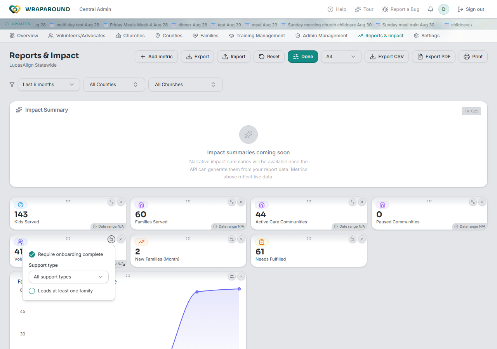

# Volunteers Active

**Who this is for:** Program staff (Admins and Coordinators).
**What it is:** A counter tile on the **Reports & Impact** page.

## What it shows

This tile counts your active volunteers. By default, a volunteer counts as "active" once they've finished onboarding, giving you a quick read on how many volunteers are ready to help.

## Options you can change

Select **Options** (the gear icon) in the top-right corner of the tile to change what gets counted. You don't need to turn on **Edit Layout** first.

- **Require onboarding complete** — on by default. This is what "active" means here: only volunteers who have finished onboarding are counted. Turn it off to count volunteers regardless of onboarding.
- **Support type** — narrow the count to volunteers offering a particular kind of help, such as Meals. The default is **All support types**. The list comes from your program's configured **Support Types**, so every support type you use is available here.
- **Leads at least one family** — a checkbox to narrow the count to volunteers who currently lead at least one family, instead of every active volunteer.

When you narrow the count, the tile's name shows it, for example *Volunteers Active · Meals · leads*.

## Which filters affect it

- **County** and **Church** apply. They narrow the tile to the volunteers in that county or at that church.
- **Date range does not apply.** Volunteer records don't carry the dates needed to narrow by time, so the tile always reflects your current volunteers. It shows a small **"Date range N/A"** badge in its bottom-right corner to make this clear.

## Tips & notes

!!! note "One copy per report"
    Volunteers Active comes with every new report. You can only have one copy at a time. If you remove it, it shows up again under **Add metric → Metrics**, so you can add it back without resetting your report.

!!! note "What \"active\" means here"
    "Active" means a volunteer has finished onboarding, not that they were recently active or recently helped with a need.

## Related

- [Build a Reports & Impact report](../admin/reports-and-impact.md)
- [Active Churches](active-churches.md)
- [Roles & permissions matrix](../../reference/permissions-matrix.md)
