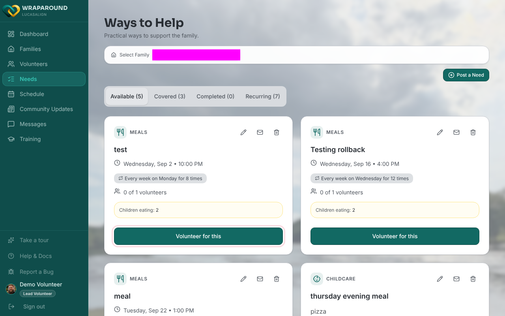
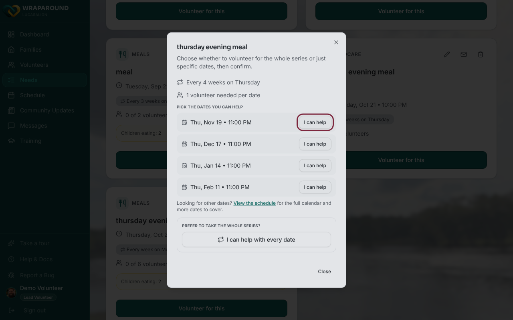

<!-- @frontend verified 2026-10-30 against Align-FrontEnd source and the live dev app as the
     demo Lead Volunteer: signing up happens on the needs board (needs.tsx), not on the
     Schedule calendar. The claim button is shown only to advocates and volunteers
     (needs.tsx, need-link.ts); admins and coordinators manage needs and have no claim button. -->

# Sign up for a slot

**Who this is for:** Volunteers and advocates. (Admins and coordinators manage needs but don't
see a sign-up button.)
**When to use it:** When there's an open need or a recurring slot you can cover.
**Before you start:** You're assigned to the family. You can also
[view the calendar](view-calendar.md) to see what's already covered.

## Steps

1. Open **Ways to Help** (volunteers) or **Needs** (leads and advocates) in the sidebar. The
   page is titled **Ways to Help**, and needs nobody has signed up for yet appear under the
   **Available** tab.

    

2. Read the details — **what's needed**, **when**, and any notes.
3. Make sure you can commit to it.
4. Click **Volunteer for this**.
    - For a **one-time** need, a **Volunteer for this?** confirmation opens. Click
      **Yes, sign me up**.
    - For a **recurring** need, a picker opens. Choose **I can help** next to a single date
      (then **Confirm commitment**), or choose **I can help with every date** and confirm
      **Claim series** to take the whole series.

    

5. The need (or the date you picked) now shows **your name**.

## What you'll see

- The need shows you as the volunteer, and the rest of the team can see it's covered.
- It appears on the [Schedule](view-calendar.md) so you can find it again.

!!! tip "If your plans change"
    If you claimed a slot but can no longer make it, use
    [**Request coverage**](../needs/request-coverage.md) — it asks the care community for
    backup without giving up your spot right away.

## Related

- [View the calendar](view-calendar.md)
- [Understand recurring events](recurring-events.md)
- [Request coverage on a need you've claimed](../needs/request-coverage.md)
