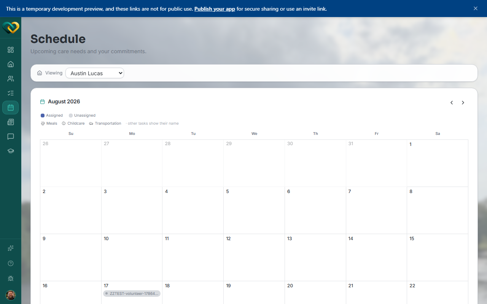
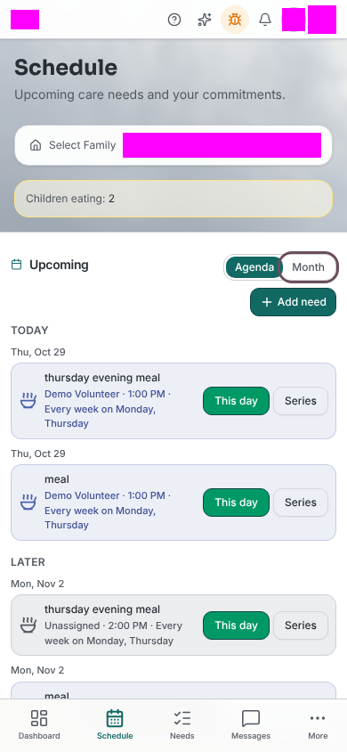
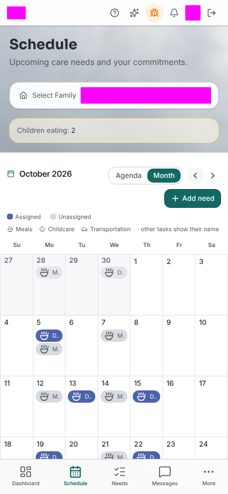
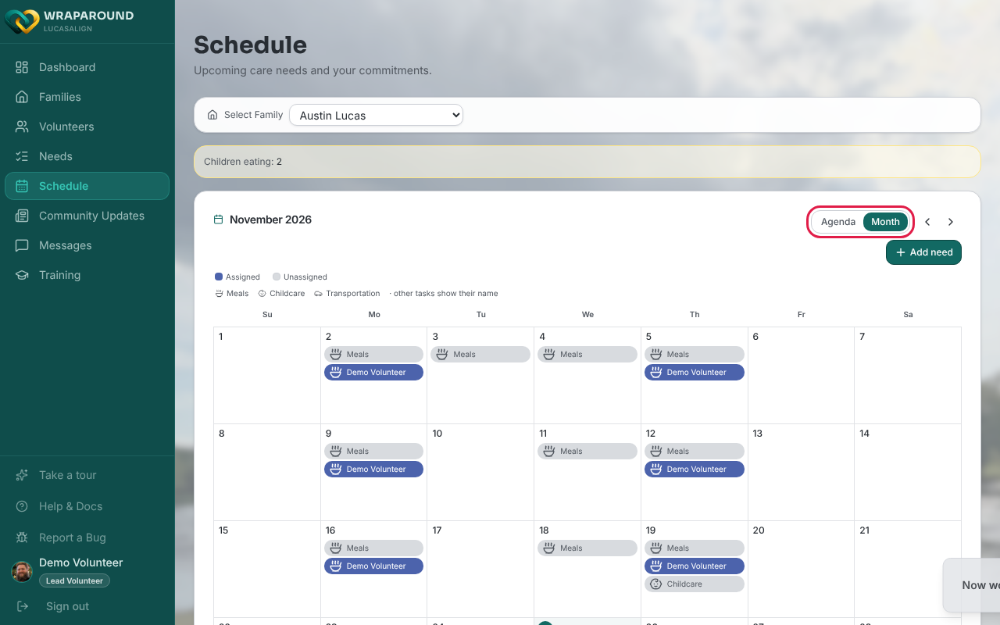
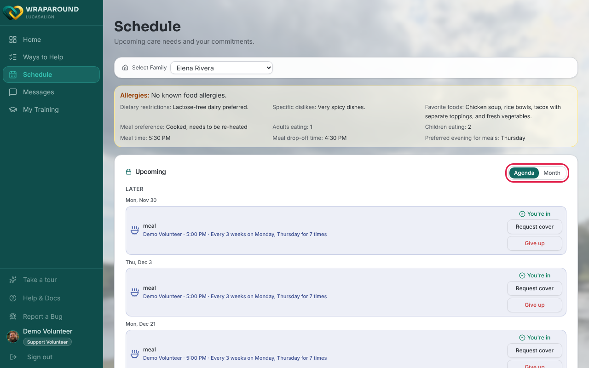

# View the calendar

**Who this is for:** Volunteers, advocates, coordinators, and families. (Admins don't have
**Schedule** in their menu.)
**When to use it:** To see what's coming up for your family and when help is needed.
**Before you start:** You've [accepted your invite and signed in](../account/accept-invite.md),
and you're assigned to a family.

## Steps

1. From the main menu, open **Schedule**. The page shows upcoming care needs and your
   commitments for the family you're viewing. If you serve more than one family, use the
   family switcher above the calendar to change families.
2. On a wide screen the Schedule opens as a **month grid**. A legend shows which entries are
   **Assigned** and which are **Unassigned**, and an icon key shows the task types (Meals,
   Childcare, Transportation, and others). Entries held by a paused volunteer show in red.
3. Use the **‹ ›** arrows next to the month name to move between months.
4. Tap a day to open it. A box lists that day's needs, each with its time, who's signed up
   (or **Unassigned**), and how often it repeats.
5. On a phone, the Schedule opens as an **Upcoming** list (the agenda) grouped into
   **Today**, **This week** and **Later**. Use the **Agenda** / **Month** toggle to switch
   views. The toggle is there on a wide screen too, so you can use the agenda on a computer.

   

   Tap **Month** to switch to the calendar grid. The toggle then sits beside the month name.

   

   On a computer, the same toggle sits next to the month name:

   

   

6. To see the standing commitments behind the calendar (who holds each repeating need),
   open the **Recurring needs** section below the calendar.

## What you'll see

Your family's upcoming needs and your own commitments. What you can do from a day depends
on your role:

- **Volunteers** can **Claim** an open entry (a repeating entry offers **Claim this day**
  and **Claim series**). On a day you're signed up for you'll see **You're in**, with
  **Request cover** and **Give up** (see [Sign up for a slot](sign-up-slot.md)). You can
  also [claim a need](../needs/browse-needs.md) on the needs board.
- **Advocates, lead volunteers and coordinators** see **Modify** on a one-time entry, or
  **This day** and **Series** on a repeating one, and an **Add need** button above the
  calendar.

!!! tip "Recurring events"
    Some entries repeat — a weekly ride, for example. See
    [Understand recurring events](recurring-events.md) so you know what you're committing to.

## Related

- [Sign up for a slot](sign-up-slot.md)
- [Understand recurring events](recurring-events.md)
- [Browse open needs](../needs/browse-needs.md)
