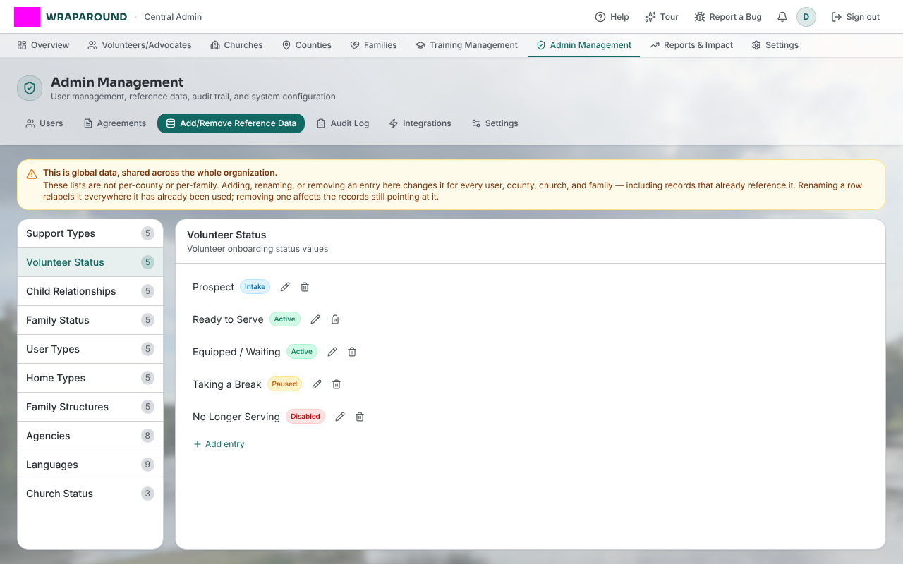

<!-- @backend verified 2026-10-22 against Align-Core: family and volunteer gates key off the admin-assigned
`category` flag (community_status / volunteer_status, #99, #455), not the status name. -->

# Statuses explained

Many records in WrapAround carry a **status** that tracks where they are in their lifecycle.
Statuses are managed lists — program staff can adjust the available options — so the live
list you see in the app is always the source of truth. Below are the standard values and
the few that drive how the system behaves.

## Family status

Tracks where a family is in the care journey.

- **Care Requested / Needs Vetting** — where a newly self-registered family starts. Staff
  must review and approve the family before it becomes active. *(The system enforces this
  gate, so this status matters.)*

Other common values include *Applicant*, *Active – Awaiting serving Church*,
*Active / Being served*, *On Hold*, and *Closed*.

Staff also assign each family status a **category** — *vetting*, *building*, *active*, or
*inactive* — and the app colours the status badge by that category, not by the status text.
*Building* is the stage after a family is approved and has signed the participation
agreement but before its care circle is assembled. A status with no category shows a
neutral badge.

## Volunteer status

Tracks where a volunteer is in their journey.

- **Prospect** — where a new or just-invited volunteer starts (the status flagged as the
  *intake* category).

Other common values include *Equipped / Waiting*, *Serving*, *Taking a Break*,
*No Longer Serving*, and *Pending team placement*.

Behind the scenes each volunteer status can carry a **category** — **Intake**, **Active**,
**Paused**, or **Disabled** — set on the status under **Add/Remove Reference Data** in the
admin area. The system acts on the category, not the status wording, so a status can be
renamed freely. A status with no category shows as **Informational** and is treated as active.

- **Paused** and **disabled** volunteers (and advocates) lose access to their families' and church's data,
  can't send or receive messages, stop getting notification emails, and can't be assigned
  to needs. When they open the app they see a full-page **Your account is paused** (or
  **Your account is disabled**) screen with a **Sign out** button, telling them their advocate
  or coordinator needs to move them out of that status.
- Moving a volunteer into a **disabled** status also turns off their sign-in; moving them
  out turns it back on.
- New volunteers start in the *intake* category (by default the **Prospect** status).

<!-- @backend verified 2026-10-21 against Align-Core #455 (volunteer_status.category,
migration aligncore/034): effects above match utils/volunteer-status.ts, messaging,
notify.ts and the volunteers handler. Which role may change the category/status is not
asserted here — confirm before marking ready. -->

## Where statuses come from

Statuses are reference lists kept centrally and editable by staff, so treat the app's
current list as authoritative. The system acts on a status's category rather than its name: a family status in the
*vetting* category gates a family's approval, and the volunteer status in the *intake*
category is the starting point for a new volunteer.
